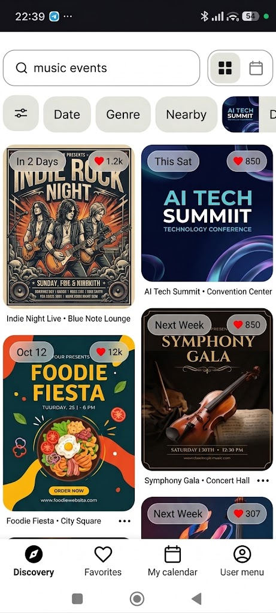

# FestDaily

**Discover, save, and never miss the local events you'd actually want to go to.**

FestDaily helps city residents and families cut through disorganized event info — scattered across social media, easy to forget, hard to search — and turns it into a searchable, filterable, personal event calendar.

> **Naming note:** this repository and its packages are still named `festgrid` (its original working name). The product itself was renamed **FestDaily** partway through development; all docs below use the current name.

[](https://github.com/sulha199/fest-grid-bmad/actions/workflows/ci.yml)
[](#testing--coverage)
[](#project-status--roadmap)
[](LICENSE)


---

## Screenshot



*Discovery feed (mobile): search, category filters, and card/calendar view toggle.*

---

## Why this repo is worth a look

This isn't just a CRUD app — it's a fully **spec-driven, AI-assisted build**: every feature traces back to a PRD line item, an architectural decision, and a story file, all committed to the repo (see [Planning & Process Artifacts](#planning--process-artifacts)). A few problems that came up along the way, and how they were solved:

- **Query sprawl across features.** Discovery feed, favorites, calendar, and per-account public pages all needed "a list of events, filtered." Rather than grow a bespoke endpoint per view, every client query — regardless of feature — compiles down to one recursive JSON **Unified Query DSL** served by a single event-query endpoint. New views become new query conditions, not new endpoints. ([architecture spine, AD-1/AD-2](_bmad-output/planning-artifacts/festgrid-architecture-spine.md))

- **Trusting the wrong boundary.** External input (scraped social posts, AI-extracted event data) and internal client input are different threat models, so they get different validators: **AJV/JSON Schema** guards the backend edge, **Zod** guards the frontend edge, and the two libraries are never mixed inside a shared package — a rule enforced structurally, not just by convention.

- **Silent data resurrection.** A naive soft-delete makes it easy for one resolver to forget the `deletedAt` filter and leak a user-hidden or moderator-reverted row back into a list. Instead, the **exclusion is enforced once**, in the shared query-building layer that every event/favorite/calendar/subscription read goes through — backed by Postgres partial indexes on the active-row subset, so the common case stays fast. ([AD-8](_bmad-output/planning-artifacts/festgrid-architecture-spine.md))

- **Finding the bottleneck before it blocks anyone.** Before implementation reached Epic 2, all six epics' readiness reports were synthesized into a ranked [critical-path report](_bmad-output/planning-artifacts/critical-path-report-2026-07-31.md) — surfacing, for example, that the GraphQL auth-context layer (Story 0.17) alone gates four downstream epics. That story got prioritized ahead of schedule instead of being discovered as a blocker mid-sprint.

- **Compute-cost-aware AI workflow.** Not every task needs the same model. Development uses **semantic task-based routing**: broad contextual analysis and user-story framing are delegated to an advanced reasoning LLM, while routine code generation is funneled to a lightweight, instruction-tuned codegen model — optimizing compute expenditure without sacrificing spec accuracy.

- **Velocity without cutting corners.** Time is treated as a resource to budget deliberately, not just spend: the [critical-path report](_bmad-output/planning-artifacts/critical-path-report-2026-07-31.md) above sequences *what* gets built first, and two structural choices control *how fast* each piece can be built and verified without quietly eroding quality — a **tiered testing strategy** (100% unit-test coverage is mandatory only in `packages/domain`, the pure business-logic layer, and is enforced by a failing CI gate rather than left to convention — see [Testing & Coverage](#testing--coverage); a meta-testing/tooling package that verifies other code rather than implementing product logic — e.g. `packages/visual-audit` — gets its own qualitative-coverage unit-test tier instead; everything else follows a "testing trophy" of integration-first tests plus E2E coverage for critical flows only, so test effort scales with actual risk instead of blanket coverage targets) and **shared, cached TypeScript builds** (every package/app extends one base `tsconfig`, and Turbo caches and parallelizes `build`/`lint`/`test` per package so a change in one workspace doesn't force a full monorepo recompile).

---

## Features

- **Event Discovery** — curated listings with free-text and `#hashtag` search (event name, performer, location) and type/category filters; discovery pages default to ongoing/upcoming events only.
- **AI Prompt Filter** — describe what you want in plain language ("jazz or blues in Sleman this weekend, not workshops"); a Gemini-backed parser turns it into a validated boolean/nested filter expression (depth and size limited), compiled by the same query layer as the manual filters, with a human-readable summary in English and Indonesian. Golden-prompt evals run nightly in CI to catch model drift.
- **Personalization** — favorite events, a dedicated favorites page, and a dedicated "added to calendar" page.
- **Saved Locations** — save multiple named locations (current-location or map-picked) and find nearby events within a configurable radius.
- **Event Management** — one-way calendar export (per schedule), centralized event detail with source-post/account attribution.
- **Calendar View** — weekly banded calendar that visually distinguishes favorited vs. added events, with independent show/hide toggles.
- **Social Media Account Subscription (BYOK)** — subscribe to Instagram accounts; posts are scraped through Apify and Bright Data (with failover and a scrape gate that never touches personal accounts), and a Gemini-powered AI agent extracts event details using a fairness-aware, round-robin quota algorithm across contributing users' API keys.
- **Multi-event Posts & De-duplication** — one post can yield several events, and a scored cross-post matcher links the same event announced more than once, routing uncertain matches to a moderator queue.
- **Manual Post Selection** — choose exactly which posts get processed, with live quota tracking, instead of blindly extracting everything.
- **Manual Correction & Moderation** — typed-input correction forms with consistency checks, AI-assisted correction previews, a user-reporting flow (cancelled / dangerous / personal), and moderator tools (review queue, merge duplicate events with slug redirects, account-type classification review).
- **Community Voting & Embeddable Widget** — register demand for an account without providing an API key, and embed event discovery on any registered site as a public widget.
- **Privacy by design** — faces are blurred before an image reaches the AI, private contact details are classified and discarded at extraction time, and account/media handling is gated per account.
- **Onboarding Wizard** — guided setup for API key + subscriptions + first post selection.
- **Global UX patterns** — installable PWA, English and Indonesian locales, infinite scroll everywhere long lists appear, context-aware "next/previous" detail navigation that respects the originating list's filters, and blocking vs. skeleton loading states used consistently.

Full functional spec: [PRD](_bmad-output/planning-artifacts/prds/festgrid-prd-2026-07-10-2047/prd.md).

---

## Architecture at a Glance

FestDaily is a `pnpm` + `turbo` monorepo:

```
apps/
  web/             Next.js 15 / React 19 frontend (Vercel)
  backend/         AWS Lambdas: GraphQL API, scraper, Apify/Bright Data webhooks, AI processor, ingestor, notifier
  infrastructure/  AWS CDK stack (API Gateway, Lambda, SQS, EventBridge, KMS, S3/CloudFront, SES)
packages/
  domain/             pure, framework-agnostic business logic — 100% test coverage enforced in CI
  ui/                 shared component library (Shadcn/ui + Radix + Tailwind)
  database/           Drizzle ORM schema & migrations (Supabase/Postgres)
  graphql-select/     GraphQL-AST -> optimized Drizzle select builder
  shared-types/       cross-app TypeScript types
  analytics/          shared PostHog instrumentation helpers
  testing-config/     shared Vitest presets and MSW handlers
  visual-audit/       Playwright-based visual-regression tooling
  eslint-config/, typescript-config/
```

The Architecture Spine records **37 binding architectural decisions (AD-1 to AD-41)** — among them the unified query DSL and single event-query endpoint, code-first schema migrations, strict three-tier frontend state (server/URL/client), single-provider analytics, single-framework i18n, JWT-verified auth context, the soft-delete convention, the scrape gate, and a planned move of subscribe-time classification and first scrape off the request path. Full rationale for each: [Architecture Spine](_bmad-output/planning-artifacts/festgrid-architecture-spine.md).

Infrastructure deep-dive by layer: [`docs/infrastructure/`](docs/infrastructure/index.md), including a current [architecture diagram and tech-stack table](docs/infrastructure/architecture-diagram.md).

### Tech Stack

| Layer | Technology |
|---|---|
| Language | TypeScript (strict mode) |
| Monorepo | pnpm workspaces + Turborepo |
| Frontend | Next.js 15, React 19, Shadcn/ui (Radix + Tailwind), MapLibre GL JS, PWA; hosted on Vercel |
| Frontend state | TanStack Query (server), `nuqs` (URL), Zustand (ephemeral client) |
| Backend | AWS API Gateway, Lambda, SQS (with dead-letter queues), EventBridge (serverless), AWS CDK |
| API | GraphQL (GraphQL Yoga; code-generated client types) |
| Database | Supabase (Postgres, transaction-mode pooler) + Drizzle ORM |
| Auth | Supabase Auth (JWT/JWKS-verified) |
| Scraping | Apify and Bright Data (Instagram), with webhook callbacks |
| AI extraction | Gemini API via a rate-limited AI Gateway adapter (BYOK keys encrypted with AWS KMS) |
| Media | S3 behind CloudFront for durable post media |
| Analytics | PostHog |
| Notifications | Firebase Cloud Messaging (push), Amazon SES (email) |
| Geolocation | Geoapify |
| i18n | next-intl (`en`, `id`) |
| Validation | AJV (backend boundary), Zod (frontend boundary) |
| Testing | Vitest, MSW, Playwright; `node:test` + c8 for `packages/domain` |
| CI/CD | GitHub Actions |

---

## Getting Started

Requires Node.js 22+ and pnpm 9.

```bash
pnpm install
pnpm dev     # turbo run dev, all apps
pnpm test    # turbo run test (includes the packages/domain coverage gate)
pnpm lint    # turbo run lint
pnpm build   # turbo run build
```

Full environment setup (Vercel, AWS, Supabase, FCM, PostHog, Geoapify credentials): see **[SETUP_WALKTHROUGH.md](SETUP_WALKTHROUGH.md)**.

---

## Testing & Coverage

Testing follows a deliberate, tiered strategy (rules in [`project-context.md`](_bmad-output/project-context.md#testing-rules)):

| Tier | Where | Approach | Coverage |
|---|---|---|---|
| Pure business logic | `packages/domain` | unit tests (`node:test` via `tsx`) | **100% lines, statements, functions and branches — enforced** |
| Application code | `apps/*`, `packages/ui`, `packages/database`, ... | "testing trophy": integration tests with Vitest + MSW, Playwright E2E for critical flows only | no numeric gate; the Definition of Done is that a PR does not lower overall coverage |
| Verification tooling | `packages/visual-audit`, `packages/graphql-select` | unit tests of pure logic; proof manifests for browser/AST surfaces | judged qualitatively |

**The `packages/domain` gate.** `pnpm --filter @festgrid/domain test` runs the suite under [c8](https://github.com/bcoe/c8) with the thresholds in [`packages/domain/.c8rc.json`](packages/domain/.c8rc.json). Below 100% on any metric the command exits non-zero, so the CI `test` step (`pnpm run test`) fails. The gate counts every file under `src/` — including files no test imports — so new untested logic fails it too; test files (`*.test.ts`, `__tests__/`) are the only exclusion. A branch that is provably unreachable may carry a `/* c8 ignore */` hint, but only with a comment saying why.

**The coverage badge.** The badge at the top reads [`docs/badges/domain-coverage.json`](docs/badges/domain-coverage.json), which is generated from the measured c8 summary (lowest of the four metrics, truncated rather than rounded). CI runs `node scripts/coverage-badge.mjs --check` after the tests and fails if the committed file no longer matches the measured coverage. After a change that moves coverage, run `pnpm --filter @festgrid/domain test && pnpm coverage:badge` and commit the result.

---

## Project Status & Roadmap

FestDaily is **actively in development**, built incrementally epic by epic, with each story implemented, then reviewed before it counts as done. The backend deploys to AWS from `master` through CI, the web app is hosted on Vercel, and the system has run against production data (see the [incident write-ups](docs/infrastructure/incidents/)).

_Snapshot of 23 Oct 2026, from [`sprint-status.yaml`](_bmad-output/implementation-artifacts/sprint-status.yaml) (last updated 15 Oct 2026) and the [backlog board](_bmad-output/implementation-artifacts/backlog.yaml)._

**309 tracked stories: 53 done, 230 implemented and awaiting code review, 1 ready for development, 22 in the backlog, 3 closed (superseded or won't-do).**

| Epic | Scope | Stories | Status |
|---|---|---|---|
| 0 | Project setup & DevOps foundation | 96 | In progress — 12 done, 64 in review, 1 ready-for-dev, 18 backlog |
| 1 | Core app & event discovery | 48 | In progress — 14 done, 34 in review |
| 2 | Personalization (favorites, saved locations, calendar) | 23 | In progress — 6 done, 14 in review, 3 backlog |
| 3 | Social media subscription, scraping & AI extraction | 85 | In progress — 12 done, 71 in review, 1 backlog |
| 4 | Data quality, correction & moderation | 21 | In progress — 2 done, 18 in review |
| 5 | Onboarding & manual event extraction | 9 | In progress — 1 done, 8 in review |
| 6 | Community voting & embeddable widget | 11 | In progress — 1 done, 10 in review |
| 7 | AI prompt-based custom event filter | 5 | **Done** (retrospective complete) |
| 8 | Account claim & image-storage self-service opt-in | — | Backlog — placeholder only, not yet specified |
| 9 | Boolean, nested & richer-date AI filters | 11 | Implemented — all 11 stories in code review |

**What the picture says.** Most planned stories are already implemented, so the bottleneck is code review (230 of 309 stories), not building. Epic 0 holds most of the remaining backlog (18 stories of tooling and foundation work).

**Next up**
- Burn down the review queue, starting with the epics that have nothing left in the backlog (1, 4, 5, 6 and 9).
- Async subscribe: moving subscribe-time classification and the first scrape off the request path is decided ([AD-41](_bmad-output/planning-artifacts/festgrid-architecture-spine.md)) but not yet built.
- Epic 8 (account claim) once its scope is specified.
- 74 open backlog items (10 bugs, 40 findings, 22 ideas, 2 proposals) awaiting triage or promotion into stories.

Live, per-story detail: [`sprint-status.yaml`](_bmad-output/implementation-artifacts/sprint-status.yaml).

---

## Planning & Process Artifacts

Every decision behind this codebase is written down, not just implied by the code:

| Artifact | What it covers |
|---|---|
| [PRD](_bmad-output/planning-artifacts/prds/festgrid-prd-2026-07-10-2047/prd.md) | Full product requirements & data schema |
| [Architecture Spine](_bmad-output/planning-artifacts/festgrid-architecture-spine.md) | The 37 binding architectural decisions (AD-1–AD-41) |
| [Epics & Stories](_bmad-output/planning-artifacts/epics.md) | Full epic/story breakdown with acceptance criteria |
| [Critical-Path Report](_bmad-output/planning-artifacts/critical-path-report-2026-07-31.md) | Cross-epic dependency analysis — which stories are true bottlenecks vs. local prerequisites |
| [Epic Readiness Reports](_bmad-output/planning-artifacts/epic-readiness/) | Per-epic architecture & foundational-dependency sweeps |
| [Sprint Status](_bmad-output/implementation-artifacts/sprint-status.yaml) | Live status of every story |
| [Infrastructure Docs](docs/infrastructure/index.md) | Per-layer infrastructure design |
| [UX Design Artifacts](design-artifacts/) | Trigger map, scenarios, design system, visual specs |

---

## Built With BMad

This project is built end-to-end using the [BMad Method](https://docs.bmad-method.org) — a spec-driven, agentic development workflow that carries a feature from PRD through architecture, epics/stories, implementation, and code review, with every stage's output committed to the repo. Curious how that workflow actually runs, or want to pick up a story yourself? See **[CONTRIBUTING.md](CONTRIBUTING.md)**.

---

## Contributing

See **[CONTRIBUTING.md](CONTRIBUTING.md)** for the BMad workflow walkthrough, repo conventions, and how to pick up a story.

## License

[MIT](LICENSE)
