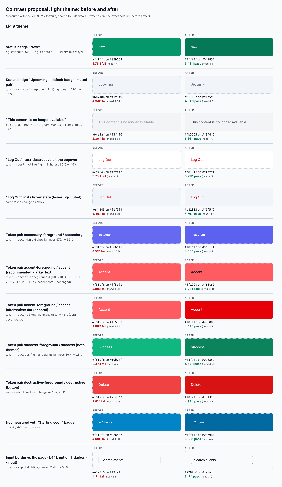
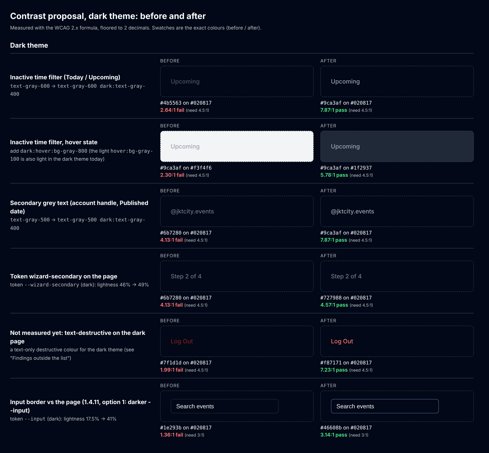

# Accessibility contrast proposal (27 Nov 2026)

**Status:** proposal for the owner to decide. No token, class or baseline was changed: `globals.css`, the components, `apps/web/e2e/a11y-baseline.json` and `KNOWN_BELOW_AA` are exactly as before. After you choose, the follow-up applies the changes and lowers the `color-contrast` cap (now 12) and the ratchet list.

**Method.** Ratios use the WCAG 2.x relative-luminance formula on 8-bit sRGB, **floored to 2 decimals**, and were computed by `design-artifacts/a11y-contrast-proposal/build.mjs` (re-runnable: `node design-artifacts/a11y-contrast-proposal/build.mjs`), not estimated. Flooring means some "before" figures read 0.01 lower than the ones quoted in the findings (4.105 is 4.10 here, 4.11 when rounded); every "after" figure is a floor, so a pass is never a rounding artefact. Only lightness changes (hue and saturation are kept), except where marked. Thresholds: 4.5:1 text, 3:1 UI components and graphics. The painted offenders were listed by axe in Chromium on the event list and event detail (desktop and phone, both themes).

**Images:** [light](../../design-artifacts/a11y-contrast-proposal/contrast-light-before-after.png) and [dark](../../design-artifacts/a11y-contrast-proposal/contrast-dark-before-after.png) before/after swatches (sources `light.html`, `dark.html`).





## Summary table

| Pair | Theme | Before | After | Change |
|---|---|---|---|---|
| Status badge "Now" | light | 3.76 (`#ffffff` on `#059669`) | 5.48 (`#ffffff` on `#047857`) | `bg-emerald-600` → `bg-emerald-700` (white text stays) |
| Status badge "Upcoming" (default badge, muted pair) | light | 4.34 (`#64748b` on `#f1f5f9`) | 4.54 (`#617187` on `#f1f5f9`) | token `--muted-foreground` (light): lightness 46.9% → 45.5% |
| "This content is no longer available" | light | 2.30 (`#9ca3af` on `#f3f4f6`) | 6.86 (`#4b5563` on `#f3f4f6`) | `text-gray-400` → `text-gray-600 dark:text-gray-400` |
| "Log Out" (`text-destructive` on the popover) | light | 3.78 (`#ef4343` on `#ffffff`) | 5.22 (`#d81313` on `#ffffff`) | token `--destructive` (light): lightness 60% → 46% |
| "Log Out" in its hover state (`hover:bg-muted`) | light | 3.45 (`#ef4343` on `#f1f5f9`) | 4.76 (`#d81313` on `#f1f5f9`) | same token change as above |
| Token pair secondary-foreground / secondary | light | 4.10 (`#f8fafc` on `#666af0`) | 4.53 (`#f8fafc` on `#5d61ef`) | token `--secondary` (light): lightness 67% → 65% |
| Token pair accent-foreground / accent (recommended: darker text) | light | 2.88 (`#f8fafc` on `#ff5c61`) | 5.91 (`#0f172a` on `#ff5c61`) | token `--accent-foreground` (light): `210 40% 98%` → `222.2 47.4% 11.2%` (accent coral unchanged) |
| Token pair accent-foreground / accent (alternative: darker coral) | light | 2.88 (`#f8fafc` on `#ff5c61`) | 4.59 (`#f8fafc` on `#e60008`) | token `--accent` (light): lightness 68% → 45% (coral becomes red) |
| Token pair success-foreground / success (both themes) | light | 2.47 (`#f8fafc` on `#10b77f`) | 4.54 (`#f8fafc` on `#0b835b`) | token `--success` (light and dark): lightness 39% → 28% |
| Token pair destructive-foreground / destructive (button) | light | 3.61 (`#f8fafc` on `#ef4343`) | 4.98 (`#f8fafc` on `#d81313`) | same `--destructive` change as "Log Out" |
| Not measured yet: "Starting soon" badge | light | 4.09 (`#ffffff` on `#0284c7`) | 5.93 (`#ffffff` on `#0369a1`) | `bg-sky-600` → `bg-sky-700` |
| Inactive time filter (Today / Upcoming) | dark | 2.64 (`#4b5563` on `#020817`) | 7.87 (`#9ca3af` on `#020817`) | `text-gray-600` → `text-gray-600 dark:text-gray-400` |
| Inactive time filter, hover state | dark | 2.30 (`#9ca3af` on `#f3f4f6`) | 5.78 (`#9ca3af` on `#1f2937`) | add `dark:hover:bg-gray-800` (the light `hover:bg-gray-100` is also light in the dark theme today) |
| Secondary grey text (account handle, Published date) | dark | 4.13 (`#6b7280` on `#020817`) | 7.87 (`#9ca3af` on `#020817`) | `text-gray-500` → `text-gray-500 dark:text-gray-400` |
| Token wizard-secondary on the page | dark | 4.13 (`#6b7280` on `#020817`) | 4.57 (`#727988` on `#020817`) | token `--wizard-secondary` (dark): lightness 46% → 49% |
| Not measured yet: `text-destructive` on the dark page | dark | 1.99 (`#7f1d1d` on `#020817`) | 7.23 (`#f87171` on `#020817`) | a text-only destructive colour for the dark theme (see "Findings outside the list") |
| Input border vs the page (1.4.11, option 1: darker `--input`) | light | 1.17 (`#e2e8f0` on `#f9fafb`) | 3.17 (`#728fb6` on `#f9fafb`) | token `--input` (light): lightness 91.4% → 58% |
| Input border vs the page (1.4.11, option 1: darker `--input`) | dark | 1.36 (`#1e293b` on `#020817`) | 3.14 (`#46608b` on `#020817`) | token `--input` (dark): lightness 17.5% → 41% |


Supporting checks:

| Extra check | Ratio |
|---|---|
| muted-foreground (before) on the page background | 4.55 |
| muted-foreground (after) on the page background | 4.76 |
| muted-foreground (after) on white | 4.97 |
| gray-500 on gray-100 (why gray-600 is needed for "no longer available") | 4.39 |
| destructive (after) text on the page background | 4.99 |
| destructive-foreground on destructive/90 hover over white, before | 3.23 |
| destructive-foreground on destructive/90 hover over white, after | 4.53 |
| secondary-foreground on secondary/80 hover over white, before | 2.94 |
| secondary-foreground on secondary/80 hover over white, after | 3.18 |
| dark text on coral accent (recommended option) | 5.91 |
| input border (after) vs white card, light | 3.32 |
| dark destructive token as text on the dark page, before | 1.99 |
| dark destructive-foreground on the dark destructive button (passes today) | 9.57 |

## Decisions, pair by pair

Recommended choices are marked **(rec.)**. "Where used" is by grep over `packages/ui/src` and `apps/web/src`, tests excluded; full per-file counts are in the appendix.

### Light theme

1. **Status badge "Now" (3.76 → 5.48).** `EventCardMediaPrimitives.tsx:446`: `bg-emerald-600 text-white` → `bg-emerald-700 text-white`. One place only (the `happeningNow` variant of `EventCardStatusBadge`, 12 px text). The emerald hue is kept, one Tailwind step darker. A hover or opacity layer is not used on this badge.
2. **Status badge "Upcoming" (4.34 → 4.54).** This is the default badge `bg-muted text-muted-foreground` (`EventCardMediaPrimitives.tsx:445`), so the fix is the token: `--muted-foreground` in `:root` goes from `215.4 16.3% 46.9%` to `215.4 16.3% 45.5%` (`#64748b` → `#617187`). It also clears the token pair muted-foreground/muted (4.34). Cost: `text-muted-foreground` is the app's general secondary text colour (about 213 matches in 82 files, appendix); all of it gets 1.4 points darker, which is barely visible, and it stays above 4.5 on the page (4.76) and on white (4.97). The dark theme is untouched. Smaller-footprint alternative: change only the badge class to `text-slate-600` (it is a different hue step and stays a one-off).
3. **"This content is no longer available" (2.30 → 6.86).** `InstagramEmbed.tsx:169` (`text-gray-400` on `bg-gray-100`): `text-gray-400` → `text-gray-600 dark:text-gray-400`. `text-gray-500` is not enough (4.39 on `#f3f4f6`), which is why it jumps to 600. The dark theme keeps gray-400 (5.78 on gray-800, passes today). Line 132 (the loading state, `text-gray-400 animate-pulse`) carries no text, only the skeleton, and needs no change; the `ImageIcon` at `opacity-50` is decorative.
4. **"Log Out" and the destructive pair (3.78 → 5.22; 3.61 → 4.98).** Token `--destructive` in `:root`: `0 84% 60%` → `0 84% 46%` (`#ef4343` → `#d81313`, a deeper red, between Tailwind red-600 and red-700). One change fixes: Log Out on white (5.22), Log Out on its `hover:bg-muted` state (3.45 → 4.76, which a smaller change such as 48% would still fail at 4.45), `destructive-foreground` on `destructive` (3.61 → 4.98), and the button hover `bg-destructive/90` (3.23 → 4.53). 46% is the smallest round value that clears all four. Where used: `text-destructive`/`border-destructive` about 67 matches in 32 files and `bg-destructive` about 24 matches in 22 files, so every destructive button, error text and delete icon gets this red. Smaller-footprint alternative for Log Out only: `text-destructive` → `text-red-700` in `UserMenu.tsx:208` (5.91 on the hover state) and leave the token alone (the token pair would stay on the ratchet list).
5. **secondary-foreground / secondary (4.10 → 4.53).** `--secondary` in `:root`: `238 82% 67%` → `238 82% 65%` (`#666af0` → `#5d61ef`). Where used: `bg-secondary`/`text-secondary-foreground`, 9 and 7 files, for example the platform pill in `SubscribedAccountCard.tsx:60`. Note: any `hover:bg-secondary/80` state stays below 4.5 (2.94 now, 3.18 after) at any reasonable lightness because the 80% opacity washes the fill out; the fix for that is to hover with `/90` or a darker fill, not a darker base, and it is outside the 12 findings today.
6. **accent-foreground / accent (2.88).** Two options:
   - **(rec.) B, dark text on the unchanged coral:** `--accent-foreground` in `:root`: `210 40% 98%` → `222.2 47.4% 11.2%` (`#0f172a`) gives **5.91**. The brand coral `#FF5A5F` is kept exactly. Visible change: the text on coral (menu hover rows, outline-button hover) goes from white to near-black.
   - A, darker coral with white text: `--accent` lightness `68%` → `45%` gives 4.59, but the coral (`#ff5c61`) becomes a pure red (`#e60008`), which is no longer the brand colour; not recommended.
   Where used: `bg-accent` 47 matches in 27 files and `text-accent-foreground` 33 matches in 22 files, mostly `hover:bg-accent hover:text-accent-foreground` (outline buttons, menu rows, `LocationPickerField.tsx:157`, `LocationPickerMapPanel.tsx:88`). In the dark theme `--accent` is a slate and is not touched.
7. **success-foreground / success (2.47 → 4.54), both themes.** `--success` in `:root` and `.dark`: `160 84% 39%` → `160 84% 28%` (`#10b77f` → `#0b835b`). This also clears the dark pair. **No component uses `bg-success`, `text-success` or `border-success` today (grep: 0)**, so the change has no visual effect now. Alternative with the brand emerald kept: dark foreground, `--success-foreground` `222.2 47.4% 11.2%` gives 6.89 on `#10b77f`. Either is free; pick the look you want for the future.
8. **muted-foreground / muted (4.34):** the same change as item 2.

### Dark theme

9. **Inactive time filter (2.64 → 7.87).** `TemporalFilterToggle.tsx:18` and the identical constant `CalendarRangeFilterToggle.tsx:38`: `'text-gray-600 hover:bg-gray-100'` → `'text-gray-600 hover:bg-gray-100 dark:text-gray-400 dark:hover:bg-gray-800'`. The current class has no dark variant at all, so near-black text sits on the near-black page. The hover needs its dark variant too: gray-400 on the existing `hover:bg-gray-100` would be 2.30 (the hover row in the swatches); on gray-800 it is 5.78. Light theme unchanged. Where used: the two constants (the two toggles render them in the list header and calendar range).
10. **Secondary grey text (4.13 → 7.87).** Append `dark:text-gray-400` wherever `text-gray-500` is text without a dark variant. Text occurrences (grep): `SubscribedAccountCard.tsx:66,74` (account handle, painted offender), `EventDetailView.tsx:657` (the section holding the "Published" date, painted offender), `EventDetailView.tsx:732` (same pattern for linked posts) and `EventDetailView.tsx:622`; also outside the 12 findings but the same defect: `WizardNavigation.tsx:32`, `WizardStepSummary.tsx:34`, `wizard-page-content.tsx:94,104`, `onboarding-api-key-step.tsx:71`. Icons at 4.13 pass the 3:1 UI rule (`EventDetailView.tsx:344,384,525,528`, `PwaInstallIosModal.tsx:96`) and need nothing. gray-400 is the next Tailwind step up (gray-500 is the failing value itself).
11. **wizard-secondary on the page (4.13 → 4.57).** `--wizard-secondary` in `.dark`: `220 9% 46%` → `220 9% 49%` (`#6b7280` → `#727988`). No component uses `text-wizard-secondary` or any other utility of this token (grep: 0 outside `globals.css`, the Tailwind config and the ratchet test), so there is no visible change today.
12. **success-foreground / success:** item 7.

## Border and input colours (1.4.11)

Today `--border` and `--input` are `214.3 31.8% 91.4%` (`#e2e8f0`, 1.17 against the page) in light and `217.2 32.6% 17.5%` (`#1e293b`, 1.36) in dark. WCAG 1.4.11 (Non-text Contrast) asks for 3:1 for the visual information needed to identify a UI component. It does **not** apply per token, it applies per component:

- **Applies:** where the border is what shows that a field exists and where to click: text inputs, textareas, search fields and select triggers drawn as an empty rounded box (for example `ui/textarea.tsx`, `ui/select.tsx`, `SearchBar.tsx`, `CorrectionForm.tsx`, `ai-assisted-correction-trigger.tsx`, `LocationPickerField.tsx`, and the dialogs' fields; the `border-input` users are listed in the appendix). Also a focus ring (`ring`, already passes) and the unchecked state of a checkbox or radio.
- **Does not apply:** card edges, dividers, table rules, separators (`border-border`, plain `border`, about 234 matches in 94 files) because they do not identify a control; and buttons whose visible text or icon identifies them (the outline `Button` has `border border-input`, `button.tsx`) as long as the label itself meets 4.5:1. The ratchet currently demands 3:1 of `border` as well, which is stricter than the criterion; I suggest dropping `border/background` from the test's pair list (or marking it decorative) whichever option you choose.

Whether a given component is "just a decorative frame" or "the only identifier" is a judgment I cannot settle from code alone; where the control also has an icon, a label, or a filled background that itself reaches 3:1, the border may be exempt, so treat the list above as the likely set.

**Option 1 (simple): darken the `--input` token only** (keep `--border` for cards and dividers): light `214.3 31.8% 91.4%` → `214.3 31.8% 58%` (`#728fb6`: 3.17 vs page, 3.32 vs white card); dark `217.2 32.6% 17.5%` → `217.2 32.6% 41%` (`#46608b`: 3.14 vs the dark page). One token, every `border-input` user passes. Trade-off: every field and outline button gets a clearly visible slate-blue outline instead of the very faint hairline, a noticeable shift of the soft look (see the "Input border" swatches); outline buttons gain a border they do not strictly need.

**Option 2 (targeted): keep `--input` as is and add a stronger field-border token** (for example `--field-border`, same values as Option 1) used only by the text-entry controls listed above (`Input`/`Textarea`/`Select` trigger/`SearchBar` and the dialog fields). Outline buttons, cards and dividers keep the soft hairline. Trade-off: the soft look survives on buttons and cards, but this adds a token and a class to touch in about a dozen components, and the design system then has two border greys that a future component has to choose between (a lint or ratchet could enforce "fields use `field-border`").

I recommend Option 2 if you want the minimum visual change and accept the extra token; Option 1 if you prefer a single rule and uniform outlines. Neither is needed for cards and dividers.

## Findings outside the list

- **`text-destructive` in the dark theme is 1.99:1** (`--destructive` in `.dark` is the dark red `0 62.8% 30.6%`, which works as a button fill with white text, 9.57, but is unreadable as text on `#020817`). It is used about 67 times as text/border colour and no scenario measures it (the profile menu is only audited in light). Proposal: a text-only colour for the dark theme (for example a `--destructive-text` token at `0 91% 71%`, `#f87171`, 7.23, or `dark:text-red-400` on those classes). Not part of the 12 findings and not in the ratchet; I suggest adding a dark profile-menu scenario when this is fixed.
- **"Starting soon" badge** (`bg-sky-600 text-white`, `EventCardMediaPrimitives.tsx:453`): 4.09, not flagged yet only because no seeded event shows it. `bg-sky-700` gives 5.93.
- **Hover states with opacity** (`hover:bg-secondary/80`, `hover:bg-destructive/90`) are separate from the base pairs, see items 4 and 5.
- A person still needs to confirm the visual feel of any darker accent or border on real screens; the swatches show exact colours, not the whole UI.

## Appendix: every use found by grep

Counts are matches per file for the stated pattern in `packages/ui/src` and `apps/web/src` (tests excluded). Utility classes with an opacity suffix, for example `bg-destructive/90`, are included in the match.

**Every use of the muted-foreground token** (`(text|placeholder|fill|stroke|border)-muted-foreground`): 213 matches

<details><summary>files and counts</summary>

```
16  apps/web/src/app/[locale]/posts/select/posts-select-content.tsx
7  apps/web/src/app/[locale]/moderator/items/moderator-items-content.tsx
7  apps/web/src/app/[locale]/jobs/[jobId]/job-technical-details.tsx
6  apps/web/src/features/moderation/reextract-preview-result.tsx
6  apps/web/src/app/[locale]/moderator/tools/actor-runs-content.tsx
6  apps/web/src/app/[locale]/moderator/items/account-type-classification-row.tsx
5  apps/web/src/app/[locale]/moderator/tools/duplicate-events-content.tsx
5  apps/web/src/app/[locale]/moderator/items/pending-location-change-row.tsx
4  packages/ui/src/features/posts/PostCard.tsx
4  packages/ui/src/features/locations/LocationPickerMapPanel.tsx
4  packages/ui/src/features/locations/LocationPickerField.tsx
4  packages/ui/src/features/jobs/JobProgressView.tsx
4  packages/ui/src/features/events/LocationRadiusFilter.tsx
4  packages/ui/src/core/app-shell/UserMenu.tsx
4  apps/web/src/components/widgets/EmbedDomainsDialog.tsx
4  apps/web/src/components/votes/RankedVoteList.tsx
4  apps/web/src/app/[locale]/settings/account/subscribe-account-dialog.tsx
4  apps/web/src/app/[locale]/moderator/items/reported-event-group.tsx
4  apps/web/src/app/[locale]/jobs/jobs-content.tsx
3  packages/ui/src/features/locations/AccountLocationField.tsx
3  packages/ui/src/features/events/SearchBar.tsx
3  packages/ui/src/features/events/EventCardMediaPrimitives.tsx
3  packages/ui/src/features/events/AIFilterOverlay.tsx
3  packages/ui/src/core/ui/calendar.tsx
3  apps/web/src/features/onboarding/onboarding-subscribe-step.tsx
3  apps/web/src/app/[locale]/widget/[id]/page.tsx
3  apps/web/src/app/[locale]/votes/page.tsx
3  apps/web/src/app/[locale]/settings/locations/location-form-dialog.tsx
3  apps/web/src/app/[locale]/settings/ai-filters/ai-filters-content.tsx
3  apps/web/src/app/[locale]/reports/report-list-item.tsx
3  apps/web/src/app/[locale]/moderator/tools/unprocessed-payloads-content.tsx
3  apps/web/src/app/[locale]/moderator/tools/resolution-clue-checklist.tsx
3  apps/web/src/app/[locale]/moderator/tools/payload-list-item.tsx
3  apps/web/src/app/[locale]/moderator/tools/moderator-accounts-content.tsx
2  packages/ui/src/features/jobs/JobStepper.tsx
2  packages/ui/src/features/events/FilterHub.tsx
2  packages/ui/src/features/events/EventListView.tsx
2  packages/ui/src/features/events/EventCardCalendarGridItem.tsx
2  packages/ui/src/features/events/CorrectionForm.tsx
2  packages/ui/src/core/tabbed-shell/TabbedShell.tsx
2  apps/web/src/features/onboarding/onboarding-api-key-step.tsx
2  apps/web/src/features/events/EventDetailWrapper.tsx
2  apps/web/src/components/votes/RegionBreakdownSheet.tsx
2  apps/web/src/components/ui/table.tsx
2  apps/web/src/components/ui/dialog.tsx
2  apps/web/src/app/[locale]/settings/widgets/page.tsx
2  apps/web/src/app/[locale]/settings/locations/locations-content.tsx
2  apps/web/src/app/[locale]/settings/account/notifications-content.tsx
2  apps/web/src/app/[locale]/reports/reports-content.tsx
2  apps/web/src/app/[locale]/posts/[platformSlug]/[postType]/[platformPostId]/events/post-events-content.tsx
2  apps/web/src/app/[locale]/jobs/job-row.tsx
2  apps/web/src/app/[locale]/[platformSlug]/[username]/account-content.tsx
1  packages/ui/src/features/jobs/JobStatusBadge.tsx
1  packages/ui/src/features/jobs/JobProgressDialog.tsx
1  packages/ui/src/features/events/EventCardCompact.tsx
1  packages/ui/src/features/events/EventCard.tsx
1  packages/ui/src/core/upgrade-cta.tsx
1  packages/ui/src/core/ui/tabs.tsx
1  packages/ui/src/core/pagination-controls.tsx
1  packages/ui/src/core/page-header.tsx
1  packages/ui/src/core/map.tsx
1  packages/ui/src/core/confirm-action-dialog.tsx
1  apps/web/src/features/posts/ExtractionStatusFilter.tsx
1  apps/web/src/features/pagination/empty-page-notice.tsx
1  apps/web/src/features/onboarding/onboarding-notification-step.tsx
1  apps/web/src/features/moderation/moderator-source-posts-panel.tsx
1  apps/web/src/features/events/ai-assisted-correction-trigger.tsx
1  apps/web/src/components/votes/CastVoteForm.tsx
1  apps/web/src/components/ui/textarea.tsx
1  apps/web/src/components/ui/sheet.tsx
1  apps/web/src/components/ui/select.tsx
1  apps/web/src/components/ui/card.tsx
1  apps/web/src/app/[locale]/settings/account/subscriptions-content.tsx
1  apps/web/src/app/[locale]/settings/account/api-keys-content.tsx
1  apps/web/src/app/[locale]/settings/account/api-key-form-dialog.tsx
1  apps/web/src/app/[locale]/moderator/tools/reextract-content.tsx
1  apps/web/src/app/[locale]/moderator/tools/payload-detail.tsx
1  apps/web/src/app/[locale]/moderator/tools/moderator-tools-content.tsx
1  apps/web/src/app/[locale]/home-content.tsx
1  apps/web/src/app/[locale]/feed/feed-content.tsx
1  apps/web/src/app/[locale]/favorites/favorites-content.tsx
1  apps/web/src/app/[locale]/archive/archive-content.tsx
```
</details>

**Every use of the destructive token as text or border** (`(text|border)-destructive`): 71 matches

<details><summary>files and counts</summary>

```
18  packages/ui/src/features/events/CorrectionForm.tsx
5  apps/web/src/app/[locale]/posts/select/posts-select-content.tsx
3  packages/ui/src/features/events/LocationRadiusFilter.tsx
3  apps/web/src/app/[locale]/settings/locations/locations-content.tsx
3  apps/web/src/app/[locale]/settings/ai-filters/ai-filters-content.tsx
3  apps/web/src/app/[locale]/settings/account/subscriptions-content.tsx
3  apps/web/src/app/[locale]/moderator/tools/actor-runs-content.tsx
2  packages/ui/src/features/events/EventListView.tsx
2  packages/ui/src/features/events/AIFilterOverlay.tsx
2  apps/web/src/app/[locale]/settings/account/api-keys-content.tsx
2  apps/web/src/app/[locale]/moderator/tools/unprocessed-payloads-content.tsx
2  apps/web/src/app/[locale]/moderator/tools/payload-detail.tsx
2  apps/web/src/app/[locale]/moderator/tools/moderator-accounts-content.tsx
2  apps/web/src/app/[locale]/moderator/tools/duplicate-events-content.tsx
2  apps/web/src/app/[locale]/moderator/items/reported-event-group.tsx
1  packages/ui/src/features/locations/LocationPickerField.tsx
1  packages/ui/src/features/locations/AccountLocationField.tsx
1  packages/ui/src/features/events/WeeklyCalendarView.tsx
1  packages/ui/src/core/ui/button.tsx
1  packages/ui/src/core/ui/badge.tsx
1  packages/ui/src/core/map.tsx
1  packages/ui/src/core/count-badge.tsx
1  packages/ui/src/core/app-shell/UserMenu.tsx
1  apps/web/src/features/moderation/reextract-preview-result.tsx
1  apps/web/src/features/moderation/reextract-job-result.tsx
1  apps/web/src/components/widgets/EmbedDomainsDialog.tsx
1  apps/web/src/components/ui/button.tsx
1  apps/web/src/app/[locale]/settings/widgets/page.tsx
1  apps/web/src/app/[locale]/settings/account/notifications-content.tsx
1  apps/web/src/app/[locale]/reports/reports-content.tsx
1  apps/web/src/app/[locale]/moderator/tools/payload-list-item.tsx
1  apps/web/src/app/[locale]/moderator/items/moderator-items-content.tsx
```
</details>

**Every use of the destructive token as fill** (`bg-destructive`): 24 matches

<details><summary>files and counts</summary>

```
2  packages/ui/src/features/events/AIFilterOverlay.tsx
2  apps/web/src/app/[locale]/moderator/tools/actor-runs-content.tsx
1  packages/ui/src/features/events/WeeklyCalendarView.tsx
1  packages/ui/src/features/events/EventListView.tsx
1  packages/ui/src/features/events/CorrectionForm.tsx
1  packages/ui/src/core/ui/button.tsx
1  packages/ui/src/core/ui/badge.tsx
1  packages/ui/src/core/map.tsx
1  packages/ui/src/core/count-badge.tsx
1  apps/web/src/components/ui/button.tsx
1  apps/web/src/app/[locale]/settings/widgets/page.tsx
1  apps/web/src/app/[locale]/settings/locations/locations-content.tsx
1  apps/web/src/app/[locale]/settings/ai-filters/ai-filters-content.tsx
1  apps/web/src/app/[locale]/settings/account/subscriptions-content.tsx
1  apps/web/src/app/[locale]/reports/reports-content.tsx
1  apps/web/src/app/[locale]/posts/select/posts-select-content.tsx
1  apps/web/src/app/[locale]/moderator/tools/unprocessed-payloads-content.tsx
1  apps/web/src/app/[locale]/moderator/tools/payload-list-item.tsx
1  apps/web/src/app/[locale]/moderator/tools/payload-detail.tsx
1  apps/web/src/app/[locale]/moderator/tools/moderator-accounts-content.tsx
1  apps/web/src/app/[locale]/moderator/tools/duplicate-events-content.tsx
1  apps/web/src/app/[locale]/moderator/items/reported-event-group.tsx
```
</details>

**Every use of the secondary token** (`(bg|text)-secondary`): 9 matches

<details><summary>files and counts</summary>

```
1  packages/ui/src/features/subscriptions/SubscribedAccountCard.tsx
1  packages/ui/src/features/events/LocationRadiusFilter.tsx
1  packages/ui/src/features/events/EventCardMediaPrimitives.tsx
1  packages/ui/src/core/ui/button.tsx
1  packages/ui/src/core/ui/badge.tsx
1  apps/web/src/components/ui/sheet.tsx
1  apps/web/src/components/ui/button.tsx
1  apps/web/src/app/[locale]/settings/locations/locations-content.tsx
1  apps/web/src/app/[locale]/settings/locations/location-form-dialog.tsx
```
</details>

**Every use of the accent token** (`(bg|text)-accent`): 47 matches

<details><summary>files and counts</summary>

```
4  packages/ui/src/core/ui/calendar.tsx
3  packages/ui/src/features/locations/LocationPickerField.tsx
3  apps/web/src/app/[locale]/settings/widgets/page.tsx
2  packages/ui/src/features/locations/LocationPickerMapPanel.tsx
2  packages/ui/src/features/locations/AccountLocationField.tsx
2  packages/ui/src/features/events/CorrectionForm.tsx
2  packages/ui/src/core/ui/button.tsx
2  packages/ui/src/core/app-shell/LogoMark.tsx
2  apps/web/src/components/widgets/EmbedDomainsDialog.tsx
2  apps/web/src/components/votes/RankedVoteList.tsx
2  apps/web/src/components/ui/button.tsx
2  apps/web/src/app/[locale]/settings/locations/locations-content.tsx
2  apps/web/src/app/[locale]/settings/account/subscribe-account-dialog.tsx
2  apps/web/src/app/[locale]/moderator/items/reported-event-group.tsx
2  apps/web/src/app/[locale]/moderator/items/pending-location-change-row.tsx
2  apps/web/src/app/[locale]/moderator/items/account-type-classification-row.tsx
1  packages/ui/src/features/events/EventDiscoveryPanel.tsx
1  packages/ui/src/core/WeekPicker.tsx
1  apps/web/src/features/subscriptions/SubscriptionCapDialog.tsx
1  apps/web/src/features/posts/ExtractionStatusFilter.tsx
1  apps/web/src/components/votes/CastVoteForm.tsx
1  apps/web/src/components/ui/select.tsx
1  apps/web/src/components/ui/dialog.tsx
1  apps/web/src/app/[locale]/settings/locations/location-form-dialog.tsx
1  apps/web/src/app/[locale]/settings/ai-filters/ai-filters-content.tsx
1  apps/web/src/app/[locale]/settings/account/subscriptions-content.tsx
1  apps/web/src/app/[locale]/settings/account/set-default-location-dialog.tsx
```
</details>

**Every use of an input border** (`border-input`): 47 matches

<details><summary>files and counts</summary>

```
5  packages/ui/src/features/events/CorrectionForm.tsx
4  apps/web/src/app/[locale]/settings/widgets/page.tsx
3  packages/ui/src/features/locations/LocationPickerField.tsx
3  apps/web/src/app/[locale]/settings/account/subscribe-account-dialog.tsx
2  packages/ui/src/features/locations/LocationPickerMapPanel.tsx
2  packages/ui/src/features/events/AIFilterOverlay.tsx
2  apps/web/src/features/onboarding/onboarding-subscribe-step.tsx
2  apps/web/src/components/widgets/EmbedDomainsDialog.tsx
2  apps/web/src/components/votes/RankedVoteList.tsx
2  apps/web/src/components/votes/CastVoteForm.tsx
2  apps/web/src/app/[locale]/settings/locations/location-form-dialog.tsx
2  apps/web/src/app/[locale]/moderator/items/reported-event-group.tsx
2  apps/web/src/app/[locale]/moderator/items/pending-location-change-row.tsx
2  apps/web/src/app/[locale]/moderator/items/account-type-classification-row.tsx
1  packages/ui/src/features/events/SearchBar.tsx
1  packages/ui/src/features/events/LocationRadiusFilter.tsx
1  packages/ui/src/core/ui/button.tsx
1  apps/web/src/features/subscriptions/SubscriptionCapDialog.tsx
1  apps/web/src/features/posts/ExtractionStatusFilter.tsx
1  apps/web/src/features/onboarding/onboarding-api-key-step.tsx
1  apps/web/src/features/events/ai-assisted-correction-trigger.tsx
1  apps/web/src/components/ui/textarea.tsx
1  apps/web/src/components/ui/select.tsx
1  apps/web/src/components/ui/button.tsx
1  apps/web/src/app/[locale]/settings/account/set-default-location-dialog.tsx
1  apps/web/src/app/[locale]/settings/account/api-key-form-dialog.tsx
```
</details>
