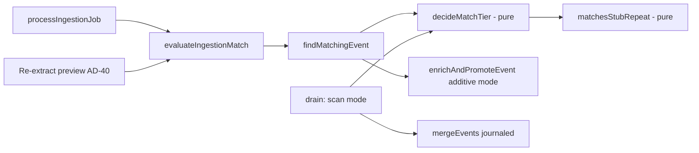

# Architecture Spine — AD-30 Rule 7 amendment: curator repeated-post auto-link

## Design Paradigm

Functional core, imperative shell. The tier decision is one pure function (`decideMatchTier`, `packages/domain/src/events/match-scoring.ts`); `apps/backend` fetches facts, calls it, and acts on the tier.

## Inherited Invariants

| Inherited | From | Binds here |
| --- | --- | --- |
| AD-30 Rule 7: weights 0.40/0.20/0.25/0.15, thresholds 0.75/0.45 | spine | Unchanged. The new rule is a tier override beside the score, never a weight change. |
| AD-30 Rule 7 (BUG-058, IDEA-068): a curator or roundup new item passes `accountId` and `organizerHandle` as `undefined` | spine | Unchanged. The stub-repeat rule never restores organizer weight; it uses no account evidence at all. |
| AD-30 Rule 7, 2026-10-18: a candidate outside the +/-2 day window is capped at `mid` | spine | Cannot conflict: the rule requires an equal start date. |
| AD-30 Rule 7, 2026-10-25: `decideMatchTier` is the one tier decision shared with the drain | spine | The rule is added inside it. |
| AD-30 Rule 9: merges go through `mergeEvents()`, journaled, undoable | spine | The scan mode merges only through it. |
| AD-30 Rule 10 / AD-31 Rule 3: a stub is a roundup-sourced or curator-sourced event; `detail_level = 'stub'`, never notifies | spine | Defines "stub" here. |
| `packages/domain` purity, 100% coverage | project-context | The predicate lives there with full tests. |

## Invariants & Rules

### AD-1 — The stub-repeat predicate is one pure function inside the tier decision

- **Binds:** `findMatchingEvent`, the drain scan mode, the AD-40 preview, the docs and diagram.
- **Prevents:** ingestion, the scan and the preview disagreeing on what a repeat is; a second, hand-rolled copy in a script.
- **Rule:** `matchesStubRepeat` (`packages/domain/src/events/`) is called only from `decideMatchTier`. When it holds, `decideMatchTier` returns tier `high` whatever the scored tier (`low` or `mid`), with `promotedByRule: true` and `promotionRule: 'stub-repeat'`. Weights, thresholds and the existing mid-to-high promotion are unchanged (`promotionRule: 'mid-to-high'`). The scan mode calls the same function.

### AD-2 — What counts as a repeat

- **Binds:** `matchesStubRepeat` and its tests.
- **Prevents:** a looser rule per caller; a repeat that merges two different events.
- **Rule:** all of, and nothing else:
  1. both events are stubs (AD-3);
  2. `normalizeEventNameStrict(new) === normalizeEventNameStrict(candidate)`, and the strict name has **at least two alphanumeric tokens** (a one-word name such as "Bazaar" or "Christmas" never qualifies). Strict means lowercase, punctuation and year tokens removed, **bracketed text kept** ("Open (Morning)" is not "Open (Evening)"). It is a sibling of `normalizeEventNameForMatch`, which deletes brackets and stays for the mid-to-high promotion. No trigram path;
  3. some schedule of each has the **same `eventStartDate`**, and on that **same schedule pair**: the venue positively matches (equal trimmed, lowercased `location` text, or coordinates within 150 m; two absent venues are not a match), **and** if both carry an `eventStartTime` the times are equal (a missing time does not block).
  The posting account, organizer, links and score are not inputs. A different curator's stub links on the same terms. **Same name and same date at a different venue are different events** (several "Christmas Market" listings on one day in different places): a venue that differs, or is unknown on either side, never matches, so the pair is left alone. The test suite names these cases: same name + date + different venue; same name + date + venue unknown on one side; same name + date + both venues unknown; one-word name; two sessions with different times; "(Morning)" vs "(Evening)".

### AD-3 — Where "stub" comes from

- **Binds:** `evaluateIngestionMatch`, `findMatchingEvent`, the scan.
- **Prevents:** a second stub definition; the preview disagreeing with ingestion.
- **Rule:** the new item's stub flag is the `isStub` that `evaluateIngestionMatch` already computes (Rule 10), passed on `MatchSourcePost`; it is never re-derived. The candidate is a stub iff `events.detail_level = 'stub'` at match time. A candidate promoted to `full` is no longer eligible. Stub-to-full and full-to-stub pairs never use this rule. The AD-40 preview inherits the flag from `evaluateIngestionMatch`; for an unstored post it treats the item as organizer-authored (not a stub), so it cannot show a stub repeat there.

### AD-4 — A stub-repeat link is additive

- **Binds:** `enrichAndPromoteEvent` and its callers.
- **Prevents:** a thin curator repost erasing or overwriting a candidate's data. Today's high path takes every non-null new field and deletes candidate schedules the new extraction omits (unless a calendar entry references them).
- **Rule:** when the match is a stub repeat, `enrichAndPromoteEvent` runs in additive mode: an event field takes the new value only where the candidate's is **unfilled**; the schedule merge inserts and fills unfilled fields but never deletes a schedule or overwrites a filled value. *Unfilled* is one shared helper: `null`, `undefined`, a blank string, an empty array, or `events.location` equal to the placeholder `'Location not specified'` (the column is NOT NULL, so null never occurs there). The `event_posts` link, the primary-post ordering (Rule 7), re-slug with alias, and `detail_level = 'stub'` are unchanged. It never notifies. Every other high match keeps today's behavior.

### AD-5 — Deterministic absorber

- **Binds:** the candidate query, the best-candidate pick, the scan winner.
- **Prevents:** with N identical stubs, the absorbing event varying run to run.
- **Rule:** the candidate query orders by name similarity descending, then `events.created_at` ascending, then `events.id`. The pick keeps the first of equal tier and score. The scan merges every loser into the cluster's oldest event (`created_at`, then `id`).

### AD-6 — The scan mode is the backlog and the race backstop

- **Binds:** `apps/backend/src/drain-event-match-backlog.ts` and `lib/events/drain-match-backlog.ts`.
- **Prevents:** historical and concurrently-ingested duplicates staying forever; an unreviewable bulk merge.
- **Rule:** a scan flag (`--scan-stubs`) over active stubs (`deleted_at` and `merged_into_event_id` null) finds pairs with a SQL pre-filter (both stubs, active, a schedule pair with an equal `event_start_date`, `similarity(event_name) > 0.5`, loose on purpose because strict-equal names can differ by a year or punctuation and so score lower) and then `matchesStubRepeat` in TypeScript, so cost is bounded by shared-date buckets, not all pairs; clusters them (union-find), and merges each loser into the AD-5 winner through `mergeEvents(winner, loser, moderatorId, null)` (journaled, undoable). Same safety as the suggestion drain: dry run (rolled back) by default; `--evaluate-only` merges nothing and runs on the read-only role; `--exclude <event id>` keeps an event out; `--apply` is all-or-nothing and only after a spot-check. Idempotent: merged losers leave the active set. A pending suggestion touching a merged event is reported stale. It prints every cluster (winner, losers, names, dates, venue), then a **near-miss list**: active stub pairs with the same strict name and the same start date that were *not* merged, each with the reason (`venue differs`, `venue unknown on one side`, `venue unknown on both`, `times differ`, `name too short`), so a moderator can see lookalikes the rule deliberately left apart.

### AD-7 — Every stub-repeat decision is observable

- **Binds:** `build-dedup-decision-log.ts`, the Logs Insights queries.
- **Prevents:** an unmeasurable rule.
- **Rule:** the `event_dedup_decision` line gains one field, `promotionRule` (`'mid-to-high' | 'stub-repeat' | null`); still no names and no account ids. `promotedByRule` stays true for both rules so existing queries keep working. The docs add the by-`promotionRule` query.

### AD-8 — Auto-links are not undoable (accepted)

- **Binds:** the decision record.
- **Prevents:** a silent assumption that this is reversible.
- **Rule:** the high path writes no `event_merges` row, so a wrong ingestion-time stub-repeat link cannot be undone with `undoEventMerge`. Accepted because a stub never notifies and AD-4 loses no data. The decision log is the audit trail; scan-mode merges are journaled.

### AD-9 — Rollout gate: spot-check before merge

- **Binds:** the PR for this amendment.
- **Prevents:** shipping an ingestion rule whose first real-world output nobody has seen. Only the scan has a dry run; the ingestion rule is live on deploy.
- **Rule:** before the PR merges, run `drain-event-match-backlog.ts --scan-stubs --evaluate-only` from the branch against the read-only prod role (it needs no deploy and no write privilege) and attach the cluster list to the PR; a moderator spot-checks it. The first `--apply` follows the same check.

## Consistency Conventions

| Concern | Convention |
| --- | --- |
| Naming | `matchesStubRepeat`, `promotionRule: 'stub-repeat'`, flag `--scan-stubs` |
| Data & formats | dates compared as `YYYY-MM-DD` strings (`eventStartDate`); names through `normalizeEventNameForMatch` only |
| State & cross-cutting | DB reads in `apps/backend`; the predicate takes plain values; the diagram `event-dedup-flow.html` and its status section change in the same PR as the code |

## Capability → Architecture Map

| Area | Lives in | Governed by |
| --- | --- | --- |
| Predicate and tier decision | `packages/domain/src/events/match-scoring.ts` (+ new `stub-repeat.ts` if it grows) | AD-1, AD-2 |
| Stub flags, candidate query order | `evaluate-ingestion-match.ts`, `match-event-to-existing.ts` | AD-3, AD-5 |
| Additive link | `set-event-primary-post.ts` | AD-4 |
| Scan and backlog | `drain-event-match-backlog.ts`, `lib/events/drain-match-backlog.ts` | AD-5, AD-6 |
| Logging and docs | `build-dedup-decision-log.ts`, `docs/infrastructure/7-event-dedup.md`, `event-dedup-flow.html`, spine Rule 7 | AD-7, AD-8 |

## Deferred

- **Scan vs live ingestion.** A post can link to an event a scan is merging away; the moderator accept has the same exposure. Run `--apply` off-hours; revisit with the advisory-lock item below.
- **Concurrent ingestion race.** The Yonex events were created seconds apart (03:24:45 and 03:24:51; three within 8 s at 03:29; three within 10 s at 03:33), so two events can be inserted before either is visible. Rule 7 designs no lock; AD-6's scan is the backstop. Revisit (per-key `pg_advisory_xact_lock`) if the scan keeps finding concurrent duplicates.
- **Generic multi-word names.** The two-token guard (AD-2) stops one-word names only. A generic two-word name ("Christmas Bazaar", "Mid Year Sale") at one venue on one date from two curators still links, because same name, date and venue is treated as one event. AD-9's spot-check and the scan's near-miss list are the controls; add a stop-list only on evidence of a wrong merge.
- **Reminder posts dated the event day.** A repost whose schedule starts on a different day than the first does not match (equal start date required). Widen only with evidence.
- **Stub to full, full to stub.** Out of scope; its own amendment.
- **Additive mode for the mid-to-high promotion.** PR #102's promotions still use the destructive enrichment; adopting AD-4 there is a follow-up.
- **Reversible auto-links.** Journaling the high path (AD-8) is a larger change; only if a wrong auto-link is reported.
- **Trigram path for stub repeats.** Near-identical names; only on evidence of misses.
