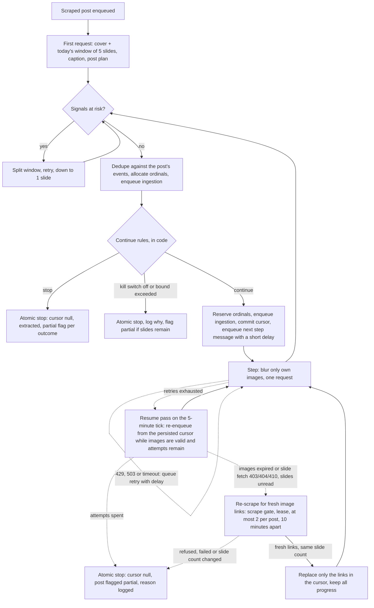
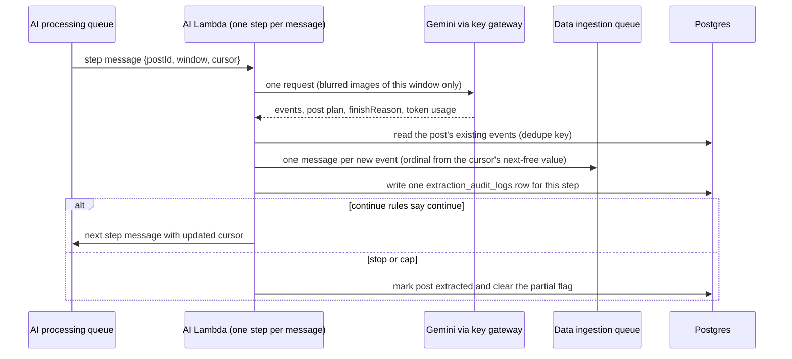

# Architecture diagrams

## Step loop

## Step message and state

The cursor is also persisted on the post (written when a step ends and cleared at a clean end), which is what the resume pass reads.

State carried in the message (stateless Lambda): post id, next slide index, next free ordinal, events found so far, empty-step count, step count, last observed items per slide, claimed item count.
