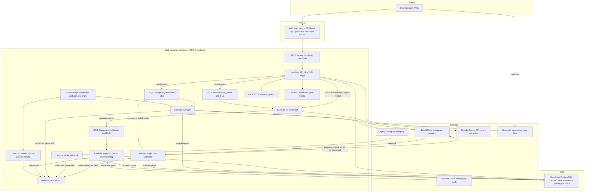

# Architecture Diagram and Tech Stack

Overview diagram and tech-stack table for FestGrid, drawn from the pages in this folder, `apps/infrastructure/lib/festgrid-backend-stack.ts` and the `package.json` files (checked against master at b5912f1, 12 Oct 2026). It extends the smaller diagram in [High-Level Overview](./high-level-overview.md).

> **Keep this diagram current.** Update this page in the same change whenever the architecture or tech stack changes: a new or removed service, queue, Lambda, scraper, database, hosting provider or major library. Also update the matching page in this folder and `high-level-overview.md`. Check against the source code, not against a summary.

## Diagram

## Tech stack by layer

| Layer | Technology | Source |
|---|---|---|
| Monorepo | Turborepo, pnpm workspaces, TypeScript | package.json |
| Frontend | Next.js 15, React 19, TypeScript, MapLibre GL JS; PWA; hosted on Vercel | package.json, docs/infrastructure/1-frontend.md |
| API | GraphQL (graphql-yoga) on AWS Lambda behind Amazon API Gateway | package.json, docs/infrastructure/2-backend.md |
| Pipeline | Amazon SQS: ScrapingQueue, AIProcessingQueue, DataIngestionQueue, each with a dead-letter queue; Amazon EventBridge schedules | docs/infrastructure/2-backend.md, CDK stack |
| Workers | AWS Lambda (Node.js): API, scraper, AI processor, ingestor, notifier | CDK stack |
| Database | Supabase PostgreSQL via the transaction-mode pooler; Drizzle ORM; postgres.js client | docs/infrastructure/3-database.md, package.json |
| Scraping | Apify and Bright Data (Instagram), with webhook callbacks | CDK stack, docs/infrastructure/testing-brightdata-webhook-locally.md |
| AI | Google Gemini via @google/genai | package.json |
| Secrets and keys | AWS KMS for BYOK keys; Secrets Manager for provider tokens | CDK stack |
| Media | S3 behind CloudFront (origin access control) for durable post media | CDK stack |
| Notifications | Firebase Cloud Messaging (push); Amazon SES (email) | docs/infrastructure/4 and 6, backend lambdas |
| Geolocation | Geoapify (geocoding with a Postgres cache; map tiles) | docs/infrastructure/5-geolocation.md |
| Validation | AJV / JSON Schema (backend), Zod (client) | package.json |
| Testing | Vitest, Playwright | package.json |
| IaC | AWS CDK (TypeScript) | apps/infrastructure |

## Known gaps between the sources
- `high-level-overview.md` shows Apify only. The CDK stack and code also use Bright Data. Treat the code as correct, and fold Bright Data into that page.
- The overview does not show the Notifier Lambda, KMS, the Bright Data path, or the S3 and CloudFront media stack. This page adds them from the CDK stack.
- The Notifier Lambda sends quota-warning and provider-down emails through SES. New-event push notifications to FCM are sent by the Ingestor after it commits, so the Ingestor holds the Firebase variables (the private key from Secrets Manager); the AI processor never reaches the push or mail path and holds neither. Every Lambda that sends mail holds `SES_FROM_EMAIL_ADDRESS` and an `ses:SendEmail` grant on both the sending-domain identity and the From address identity (a verified address can send, which is what the SES sandbox allows); `festgrid-backend-stack.test.ts` fails for a sender address without its grant. The API Lambda's exact FCM and SES wiring was not traced.
- SES state is not in the code. The stack creates only the domain identity (`festdaily.app`); whether it, the From address and the recipients are verified, and whether the account is still in the SES sandbox, are account settings (BUG-073).
- Apify and Bright Data each have their own webhook Lambda (`apify-webhook.ts` and `webhook.ts`). Retries of the webhook deliveries themselves were not traced.
- Result handling (Architecture Spine AD-43). The Bright Data webhook checks a delivery with no records against Bright Data's progress endpoint: a vendor failure is recorded FAILED and its profile re-queued to the ScrapingQueue (through the account-type gate, AD-34). The hourly stale-job sweep in the Scraper Lambda does the same for jobs whose webhook never arrived, for both vendors. A scrape starts from the newest stored post of the profile, never from the last run's finish time. A provider whose recent runs mostly failed or returned no posts is skipped, bar a few probe triggers, and recorded as a failure day in `scraper_provider_health`. The webhook Lambda therefore holds the Bright Data token and the ScrapingQueue send permission, asserted by `festgrid-backend-stack.test.ts`.
