# Architecture Diagram and Tech Stack

Overview diagram and tech-stack table for FestGrid, drawn from the pages in this folder, `apps/infrastructure/lib/festgrid-backend-stack.ts` and the `package.json` files (checked against master at b5912f1, 12 Oct 2026; the dedup review rows and nodes were updated on 3 Nov 2026). It extends the smaller diagram in [High-Level Overview](./high-level-overview.md).

> **Keep this diagram current.** Update this page in the same change whenever the architecture or tech stack changes: a new or removed service, queue, Lambda, scraper, database, hosting provider or major library. Also update the matching page in this folder and `high-level-overview.md`. Check against the source code, not against a summary.

## Diagram

```mermaid
graph TD
    subgraph Client
        U["User browser: PWA"]
    end

    subgraph Vercel
        W["Web app: Next.js 15, React 19, TypeScript, MapLibre GL JS"]
    end

    subgraph AWS["AWS serverless backend, CDK, TypeScript"]
        APIGW["API Gateway: throttling, rate limits"]
        L_API["Lambda: API, GraphQL Yoga"]
        EB["EventBridge: schedules and poll-and-drain"]
        L_Scrape["Lambda: Scraper"]
        L_HookA["Lambda: Apify webhook"]
        L_HookB["Lambda: Bright Data webhook"]
        L_AI["Lambda: AI processor"]
        L_Ingest["Lambda: Ingestor, dedup and matching"]
        L_Notify["Lambda: Notifier, quota-warning emails"]
        Q1["SQS: ScrapingQueue and DLQ"]
        Q2["SQS: AIProcessingQueue and DLQ"]
        Q3["SQS: DataIngestionQueue and DLQ"]
        KMS["KMS: BYOK key encryption"]
        S3["S3 and CloudFront: post media"]
        SES["Amazon SES: email"]
        OPS["CloudWatch alarms and SNS topic: ops alerts, prod only"]
        S3B["S3: nightly database dumps, 30-day retention"]
        S3L["S3: private labelled posts for the extraction eval (planned, not created yet)"]
    end

    subgraph GitHub["GitHub Actions"]
        GHA_BK["Production DB Backup: nightly and manual pg_dump"]
        GHA_RT["Production DB Restore Test: restores the newest dump after each backup"]
        GHA_DE["Dedup Review Export: manual, read-only evidence JSON of the pending dedup queue for the AI reviewer"]
        GHA_DA["Dedup Review Apply: manual; validate is read-only, apply (dry run or live) waits for the owner's approval in dedup-review-live and merges accepted pairs"]
        GHA_EV["Extraction Accuracy Eval: non-blocking; PRs touching extraction code, weekly, manual; replays a synthetic set, or scores a private labelled set live"]
    end

    subgraph GitHubIssues["GitHub Issues"]
        GH_ISSUES["dedup-escalate issues and the rolling dedup-insight log"]
    end

    subgraph ClaudeCloud["Claude cloud session (no production database credentials)"]
        AI_SKILL["moderator-dedup-review skill: decides which pending dedup pairs are obvious, opens escalation issues, logs each run on the dedup-insight issue"]
    end

    subgraph Data
        DB["Supabase PostgreSQL: Drizzle ORM, transaction pooler port 6543"]
    end

    subgraph External
        Apify["Apify: Instagram scraping"]
        BD["Bright Data: Instagram scraping"]
        Gemini["Google Gemini API: event extraction"]
        Geo["Geoapify: geocoding, map tiles"]
        FCM["Firebase Cloud Messaging: push"]
    end

    U --> W
    W --> APIGW --> L_API
    U -- map tiles --> Geo

    EB --> L_Scrape
    L_API -- on-demand --> Q1
    Q1 --> L_Scrape
    L_Scrape --> Apify
    L_Scrape --> BD
    Apify -- webhook --> L_HookA
    BD -- webhook --> L_HookB
    L_HookB -- progress lookup on an empty result --> BD
    L_HookB -- re-queue a failed profile --> Q1
    L_HookA -- scraped posts --> DB
    L_HookB -- scraped posts --> DB
    L_Scrape -- scraped posts --> DB

    L_API -- select posts --> Q2
    Q2 --> L_AI
    L_API -- manual correction, async invoke --> L_AI
    L_API -- start a job, async invoke of its host --> L_Scrape
    L_API -- start a job hosted on the AI processor, async invoke --> L_AI
    L_Scrape -- job phase hand-off, async invoke with the job id --> L_AI
    EB -- every 5 minutes, job sweep --> L_Scrape
    L_API -- jobs, job attempts --> DB
    L_Scrape -- jobs, job attempts --> DB
    L_AI -- jobs, job attempts --> DB
    L_AI --> Gemini
    L_AI -- extracted events --> Q3
    Q3 --> L_Ingest
    L_Ingest --> DB

    EB --> L_Notify
    L_Ingest -- new-event push --> FCM
    L_Notify --> SES
    L_Ingest -- failure alert --> SES
    L_Scrape -- audit-trail failure alert --> SES
    L_HookA -- audit-trail failure alert --> SES
    L_HookB -- audit-trail failure alert --> SES
    L_Scrape -- ProviderDegraded and ProviderRecovered metric lines --> OPS
    L_HookA -- PostsSaved metric lines --> OPS
    L_HookB -- PostsSaved metric lines --> OPS
    L_Scrape -- PostsSaved metric lines --> OPS
    L_API --> DB
    L_API --> Geo
    L_API --> KMS
    L_API --> S3
    GHA_BK -- pg_dump over the session pooler, port 5432 --> DB
    GHA_BK -- uploads the dump --> S3B
    S3B -- newest dump --> GHA_RT
    GHA_RT -- read-only row and object counts --> DB
    GHA_DE -- read-only evidence queries, READ ONLY transaction --> DB
    GHA_DA -- validate: read-only checks, READ ONLY transaction --> DB
    GHA_DA -- apply: guarded merges through resolveSuggestedMatch, write role, owner approval --> DB
    GHA_EV -. live path only, when the secrets are set: reads the labelled set .-> S3L
    GHA_EV -. live path only: paced extraction calls .-> Gemini
    AI_SKILL -- dispatches the export on master, reads its report from the job log --> GHA_DE
    AI_SKILL -- opens and closes labelled issues, one comment per run --> GH_ISSUES
    AI_SKILL -- dispatches validate; apply only when the owner says so --> GHA_DA
```

## Tech stack by layer

| Layer | Technology | Source |
|---|---|---|
| Monorepo | Turborepo, pnpm workspaces, TypeScript | package.json |
| Frontend | Next.js 15, React 19, TypeScript, MapLibre GL JS; PWA; hosted on Vercel | package.json, docs/infrastructure/1-frontend.md |
| API | GraphQL (graphql-yoga) on AWS Lambda behind Amazon API Gateway | package.json, docs/infrastructure/2-backend.md |
| Pipeline | Amazon SQS: ScrapingQueue, AIProcessingQueue, DataIngestionQueue, each with a dead-letter queue; Amazon EventBridge schedules | docs/infrastructure/2-backend.md, CDK stack |
| Workers | AWS Lambda (Node.js): API, scraper, AI processor, ingestor, notifier | CDK stack |
| Background jobs | One `jobs` record (with `job_attempts`) for every long vendor-backed action, a handler registry, and one worker that runs in the scraper or AI-processor Lambda. Started and handed off by async Lambda invoke carrying only the job id; ended by a database-only sweep every 5 minutes (a second EventBridge rule beside the hourly vendor sweep). Since Story 10.3 a job holds one of its owner's places (3 at once) from admission, the rest wait in a per-user queue, a due WAITING job is re-admitted through the same queue, the same work started twice is one job, and the same sweep also expires over-waited queued jobs and promotes queued jobs into free places. The subscription cap (5 for every non-moderator, counting reserved slots) uses the same per-user row lock. No new Lambda, queue or secret | CDK stack, Architecture Spine AD-53, apps/backend/src/lib/job-engine |
| Database | Supabase PostgreSQL via the transaction-mode pooler; Drizzle ORM; postgres.js client | docs/infrastructure/3-database.md, package.json |
| Scraping | Apify and Bright Data (Instagram), with webhook callbacks. Profile lookups go through swappable profile scraper adapters (`PROFILE_SCRAPER_PROVIDER_ORDER`) | CDK stack, docs/infrastructure/testing-brightdata-webhook-locally.md |
| AI | Google Gemini via @google/genai | package.json |
| Secrets and keys | AWS KMS for BYOK keys; Secrets Manager for provider tokens | CDK stack |
| Media | S3 behind CloudFront (origin access control) for durable post media | CDK stack |
| Backups | Nightly and on-demand `pg_dump` (custom format) from a GitHub Actions runner to a private, encrypted S3 bucket with 30-day expiry; Supabase free plan has no managed backups. After each backup a restore test restores the dump into a throwaway `postgres:17` container and compares it with production | .github/workflows/prod-db-backup.yml, .github/workflows/prod-db-restore-test.yml, scripts/compare-restored-db.sh, CDK stack, docs/infrastructure/3-database.md |
| AI dedup review (export) | A manual GitHub Actions workflow prints the pending dedup suggestions and their evidence as one JSON line, read-only (`READ ONLY` transaction, a read-only role that bypasses RLS), for a reviewer with no database credentials. The apply side is a second manual workflow (below) | .github/workflows/dedup-review-export.yml, apps/backend/src/dedup-review-export.ts, docs/infrastructure/7-event-dedup.md |
| AI dedup review (skill) | A repo skill a cloud Claude session follows: it dispatches the export, decides, dispatches `validate`, opens a labelled escalation issue for every pair it does not accept, and logs each run on a rolling `dedup-insight` issue. It never approves a deployment; a live `apply` happens only on the owner's word | .claude/skills/moderator-dedup-review/, docs/infrastructure/7-event-dedup.md |
| AI dedup review (apply) | A manual GitHub Actions workflow with a `validate` mode (read-only, the read-only role, no approval) and an `apply` mode (a dry run unless live) that uses a write role from the separate `dedup-review-live` environment and waits for the owner's approval on every run. Accepted pairs merge through the moderator's own `resolveSuggestedMatch` with `via: 'ai_skill'` (since FIND-120, 2026-11-07, the same function can also record a reject, off unless the owner switches it on), under a deterministic floor, per-run and per-day caps, a fail-closed kill switch and a check that `master` has not moved. Architecture decision AD-45. The write secret holds the narrow role `dedup_review_apply` (created 2026-11-03, after the actions were pinned by SHA) | .github/workflows/dedup-review-apply.yml, scripts/dedup-review-apply-guard.sh, apps/backend/src/dedup-review-apply.ts, docs/infrastructure/3-database.md, docs/infrastructure/7-event-dedup.md |
| Extraction accuracy eval | A non-blocking GitHub Actions workflow that scores event extraction field by field against hand-labelled posts, with a baseline and a noise band. It runs on PRs that touch extraction code, weekly and by hand. Without secrets it replays a committed synthetic set and says so; with them it fetches a private labelled set from S3 and makes paced Gemini calls (no database access). Images and captions are never uploaded as artifacts | .github/workflows/extraction-accuracy-eval.yml, apps/backend/scripts/run-extraction-accuracy-eval.ts, packages/domain/src/extraction-eval/, docs/infrastructure/extraction-accuracy-eval.md |
| Notifications | Firebase Cloud Messaging (push); Amazon SES (email) | docs/infrastructure/4 and 6, backend lambdas |
| Operations alerts | CloudWatch Embedded Metric Format lines from the Lambdas, three CloudWatch alarms and an SNS topic with an optional e-mail subscription (prod only; needs no SES) | CDK stack, `apps/backend/src/lib/metrics/emit-metric.ts` |
| Geolocation | Geoapify (geocoding with a Postgres cache; map tiles) | docs/infrastructure/5-geolocation.md |
| Validation | AJV / JSON Schema (backend), Zod (client) | package.json |
| Testing | Vitest, Playwright; `node:test` with c8 for `packages/domain`, whose 100% coverage gate runs in CI | package.json, packages/domain/.c8rc.json |
| IaC | AWS CDK (TypeScript) | apps/infrastructure |

## Known gaps between the sources
- Late vendor results (Architecture Spine AD-53 Rule 16, Story 10.5, 2026-11-11). A Bright Data snapshot still running when a job's post fetch gave up is linked to the job (one new table, `job_vendor_snapshots`); the existing 5-minute job sweep collects it when it is ready and finishes the job "completed after deadline", and gives up after `BRIGHTDATA_SNAPSHOT_MAX_WAIT_MINUTES` (default 480). The hourly daily-batch sweep also waits for a snapshot still running, under the same bound, instead of falling back to Apify at once. No new Lambda, queue, rule or secret; no job type has a late-result handler yet.
- Post scraper chain (Architecture Spine AD-53 Rule 15, Story 10.2, 2026-11-11). Fetching one post tries Bright Data, then Apify (setting `POST_SCRAPER_PROVIDER_ORDER`, default `brightdata,apify`, on the Scraper Lambda), skips a provider whose monthly cap is known to be used up (one new nullable column, `scraper_provider_usage.capacity_exhausted_until`, held for the rest of the cycle or three days, whichever is sooner; it also stops the daily batch repeating refused Apify starts) or that is degraded, and writes one `job_attempts` row per provider considered. No production caller uses it yet; no new Lambda, queue, rule or secret.
- Background jobs (Architecture Spine AD-53, Stories 10.1a and 10.3, 2026-11-11). Story 10.3 adds admission, the per-user queue, re-admission, reuse and opt-in sharing, and the subscription cap, with four settings (`MAX_CONCURRENT_JOBS_PER_USER`, `MAX_QUEUED_JOBS_PER_USER`, `JOB_QUEUE_MAX_WAIT_MINUTES`, `MAX_SUBSCRIBED_ACCOUNTS_FREE_USER`) on the API, scraper and AI-processor Lambdas, two columns and two partial indexes on `jobs`, and more steps in the existing 5-minute sweep (no new Lambda, queue, rule or secret). The engine exists but no job type is registered yet, so nothing in production uses it: subscribe, re-extract and the other long actions adopt it in Stories 10.6 to 10.12a. The API Lambda has two invoke edges (the Scraper for a job type hosted there; the AI processor for a type hosted there, the grant of Story 4.2b), and the Scraper Lambda has one to the AI processor for a phase hand-off. There is no reverse hand-off.
- `high-level-overview.md` shows Apify only. The CDK stack and code also use Bright Data. Treat the code as correct, and fold Bright Data into that page.
- The overview does not show the Notifier Lambda, KMS, the Bright Data path, or the S3 and CloudFront media stack. This page adds them from the CDK stack.
- The Notifier Lambda sends quota-warning and provider-down emails through SES. New-event push notifications to FCM are sent by the Ingestor after it commits, so the Ingestor holds the Firebase variables (the private key from Secrets Manager); the AI processor never reaches the push or mail path and holds neither. Every Lambda that sends mail holds `SES_FROM_EMAIL_ADDRESS` and an `ses:SendEmail` grant on both the sending-domain identity and the From address identity (a verified address can send, which is what the SES sandbox allows); `festgrid-backend-stack.test.ts` fails for a sender address without its grant. The API Lambda's exact FCM and SES wiring was not traced.
- The ops alarms (IDEA-096) are the one alert path that does not use SES: `OpsMetric` lines (`PostsSaved` per newly inserted post, `ProviderDegraded` and `ProviderRecovered` on the daily batch's transition) become CloudWatch metrics under the `FestGrid/Backend` namespace, and three prod-only alarms publish to an SNS topic. The e-mail subscription is created only when the deploy variable `OPS_ALERT_EMAIL` is set, and the recipient must click the confirmation link SNS sends. The `PostsSaved` alarm treats a day with no datapoint as a breach, so a quiet day with nothing new also trips it.
- SES state is not in the code. The stack creates only the domain identity (`festdaily.app`); whether it, the From address and the recipients are verified, and whether the account is still in the SES sandbox, are account settings (BUG-073).
- Apify and Bright Data each have their own webhook Lambda (`apify-webhook.ts` and `webhook.ts`). Retries of the webhook deliveries themselves were not traced.
- Profile scraping (2026-10-31). `instagramScraperAdapter.lookupAccountProfile` and `getAccountClassificationProfile` ask a chain of `ProfileScraperAdapter`s (`@festgrid/domain`; Apify in `instagram-adapter.ts`, Bright Data in `brightdata-profile-adapter.ts`) in the order of `PROFILE_SCRAPER_PROVIDER_ORDER` (default `apify,brightdata`). Each adapter declares the smallest time budget it needs: Apify answers in seconds, Bright Data's Instagram Profiles dataset in ~80 s (its synchronous call answers 202 at 60 s, then the snapshot is polled), so the 28 s API Lambda never starts Bright Data and a caller with a longer budget (`options.budgetMs`) does. No new service or Lambda.
- Result handling (Architecture Spine AD-43). The Bright Data webhook checks a delivery with no records against Bright Data's progress endpoint: a vendor failure is recorded FAILED and its profile re-queued to the ScrapingQueue (through the account-type gate, AD-34). The hourly stale-job sweep in the Scraper Lambda does the same for jobs whose webhook never arrived, for both vendors. A scrape starts from the newest stored post of the profile, never from the last run's finish time. A provider whose recent runs mostly failed or returned no posts is skipped, bar a few probe triggers, and recorded as a failure day in `scraper_provider_health`. The webhook Lambda therefore holds the Bright Data token and the ScrapingQueue send permission, asserted by `festgrid-backend-stack.test.ts`.
